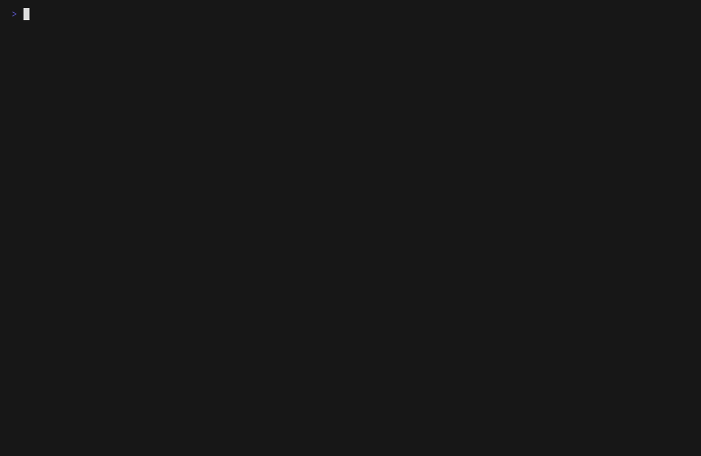

# Nginxlings

Nginxlings teaches NGINX through small exercises that you run in your terminal. Each exercise starts with a configuration that does not work yet: you read the instructions, fix the files, and press `c` to have your work checked.



There are 18 exercises, from a first static server to reverse proxying, load balancing, TLS and shared memory zones. The app, the instructions and the hints are in English and Turkish.

Türkçe kurulum rehberi: [docs/INSTALL.tr.md](docs/INSTALL.tr.md).

## Install

Download the file for your distribution from the latest GitHub Release. Most
desktops install it on a double-click; the terminal command is given too.

| Distribution | File | Command |
| --- | --- | --- |
| Ubuntu, Debian, Linux Mint, Pop!_OS | `nginxlings_<version>_amd64.deb` | `sudo apt install ./nginxlings_<version>_amd64.deb` |
| Fedora, Rocky, AlmaLinux, RHEL | `nginxlings-<version>-1.x86_64.rpm` | `sudo dnf install ./nginxlings-<version>-1.x86_64.rpm` |
| openSUSE | `nginxlings-<version>-1.x86_64.rpm` | `sudo zypper install --allow-unsigned-rpm ./nginxlings-<version>-1.x86_64.rpm` |
| Arch, Manjaro | `nginxlings-<version>-1-x86_64.pkg.tar.zst` | `sudo pacman -U ./nginxlings-<version>-1-x86_64.pkg.tar.zst` |
| Any other (Alpine, Void, ...) | `nginxlings_<version>_linux_amd64.tar.gz` | extract it, then `./install.sh` |

ARM64 machines use the `arm64` / `aarch64` files. The package manager also
installs what the exercises run: bash, curl, NGINX, Python 3, tmux and Docker,
and the package starts the Docker service. `install.sh` does the same with the
distribution's package manager and installs nginxlings in `/usr/local`.

On Rocky, AlmaLinux and RHEL the package installs Podman's `docker` command
instead of Docker. Every exercise runs with it except 10, which teaches
Docker's embedded DNS server on `127.0.0.11`; install Docker CE from Docker's
repository for that one. The setup check (`d`, `--doctor`) notes this, and
exercise 10's check stops with the same explanation instead of failing later.

To remove nginxlings, remove the package (`sudo apt remove nginxlings`,
`sudo dnf remove nginxlings`, `sudo pacman -R nginxlings`) or run
`./install.sh --uninstall`. Your work in `~/nginxlings` is kept.

### Supported platforms

The supported runtime and release target is Linux on AMD64 and ARM64: packages
for the Debian, Fedora/RHEL/openSUSE and Arch families, and `install.sh` for
other distributions.

Native macOS and Windows builds are not produced. Windows users may run a Linux release through WSL2 with Docker integration.

### Without installing

To try nginxlings without installing it, extract the complete `tar.gz` archive
and keep `exercises/` and `i18n/` beside the `nginxlings` binary:

```sh
tar -xzf nginxlings_<version>_linux_<arch>.tar.gz
./nginxlings --version
```

The archive holds only nginxlings and its exercises; `./nginxlings --doctor`
names the tools that are still missing.

### Verifying a download

Each release includes `checksums.txt` for SHA-256 verification; releases made
while the repository is public also carry GitHub artifact attestations. npm and
Homebrew packages are not published; this keeps installation independent from
npm registry packages and lifecycle scripts.

## Using Nginxlings

Open Nginxlings from the application menu, or type `nginxlings` in a
terminal. On first start it copies the exercises to `~/nginxlings`, where you
edit them; `o` opens the selected exercise's folder. If something is still
missing, usually Docker access for your user, the status row shows
`! Setup` and `d` explains the fix; `f` runs it.

The left panel lists the exercises and the right panel shows the selected
exercise's instructions. In the list, `✓` marks an exercise whose check passed
and `x` one that has not passed yet; exercises you have not checked at all are
dimmed.

- `w` / `s`: select an exercise
- `up` / `down`: scroll instructions
- `pgup` / `pgdown`: scroll faster
- `left` / `right`: horizontal scroll
- `c` or `enter`: run the selected exercise check
- `tab`: toggle between instructions and the last check output, which opens at
  its end where the result is
- `h`: show the selected exercise's hint (press again to return)
- `d`: setup check: what the exercises still need and how to fix it
- `?`: list every key in the right panel
- `t`: take the terminal below to the selected exercise's folder (without tmux: open a shell there; `exit` returns)
- `F2`: move between nginxlings and the terminal below; a mouse click works too
- `Alt+↑` / `Alt+↓`: make the terminal taller or shorter; dragging the line above it works too
- `o`: open the selected exercise's folder in the file manager
- `e`: restore the selected exercise's starting files (installed package only; asks first)
- `l`: switch language
- `r`: reset progress
- `q`: quit (ends the terminal below too)

### Terminal pane

When tmux is installed (the packages install it), `nginxlings` starts in a tmux
session of its own: the app on top and a shell in the selected exercise's
folder at the bottom, so editing files and running commands needs no second
terminal window. Double lines frame the terminal: the one above names the keys,
the one below shows the terminal's folder, and their text turns orange while
the terminal has the keyboard. The session uses its own
tmux server and configuration, so your tmux setup is not touched, and it ends
when you quit nginxlings or close the window. The mouse works in tmux there: to
select text with it, hold `Shift` while dragging.

Inside an existing tmux session, nginxlings runs in the current pane and `t`
splits a terminal below it. `--no-tmux` or `NGINXLINGS_NO_TMUX=1` runs without
the pane; `t` then opens a full-screen shell in the exercise folder, and `exit`
returns to nginxlings.

### Troubleshooting

If a check fails because a command is missing, install the required command shown in the failure message. Common missing commands are `nginx`, `docker`, `curl`, `bash`, and `python3`.

If a Docker exercise fails to start, check that Docker is running and that the exercise's default host port is not already in use. Several checks allow port overrides through environment variables documented in the script, for example:

```sh
HOST_PORT=18199 ./check.sh
```

If a local NGINX exercise fails on port `8080` or `8081`, stop the process already using that port before rerunning the check.

### Your files and progress

An installed nginxlings cannot let you edit the exercises where the package
put them, so it copies them to `~/nginxlings` and you work on that copy. Every
start updates the copy from the installed version: new exercises and files are
added, check scripts, READMEs and the shared library are replaced, and other
files are replaced only while you have not changed them. `--workspace <path>`
or `NGINXLINGS_WORKSPACE` picks another folder.

Progress is stored in `~/.local/state/nginxlings/state.json`, or in
`$XDG_STATE_HOME/nginxlings/state.json` when that variable is set: the result
of each exercise's last check, the last selected exercise and the language.

## Command Line

`nginxlings` without flags opens the app. `nginxlings --help` lists every flag
and environment variable; the ones a learner needs are below.

Show the version:

```sh
nginxlings --version
```

List the exercises in the order the app shows them:

```sh
nginxlings --list
```

Check that the tools the exercises need are installed and that Docker answers; each problem comes with the command that fixes it, and the exit code is 1 while something is missing:

```sh
nginxlings --doctor
nginxlings --doctor --lang tr
```

Run one exercise's check on your files without opening the app; the result is printed and your progress is not changed:

```sh
nginxlings --check 01_static_server
```

Open the app in a given language:

```sh
nginxlings --lang tr
nginxlings --lang en
```

An unknown language code exits with an error that lists the available languages.

## Contributing

[CONTRIBUTING.md](CONTRIBUTING.md) covers running nginxlings from source, the project layout, the tests, translation rules and the checklist for adding exercises. Contributions are accepted under `AGPL-3.0-only`.

## License

Copyright (c) 2026 Kenan Ayberk Özkan.

Nginxlings is free software under [`AGPL-3.0-only`](LICENSE): you may use, study, modify and redistribute it, and a modified version, including one offered over a network, must make its complete source available under the same license.
